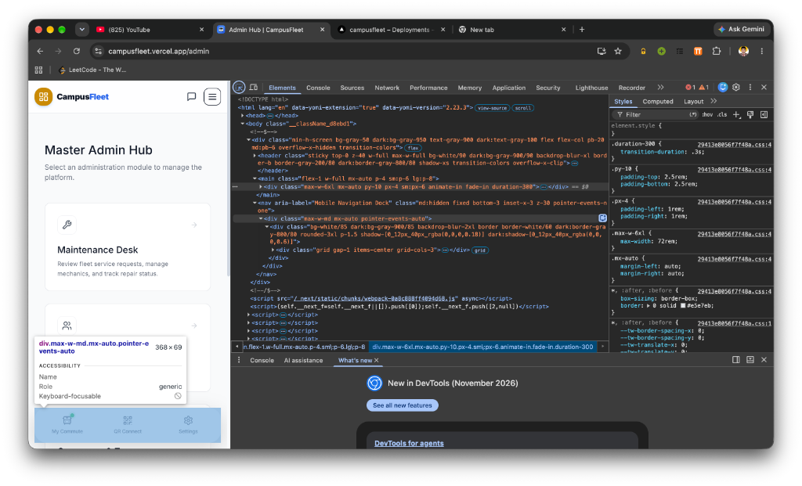
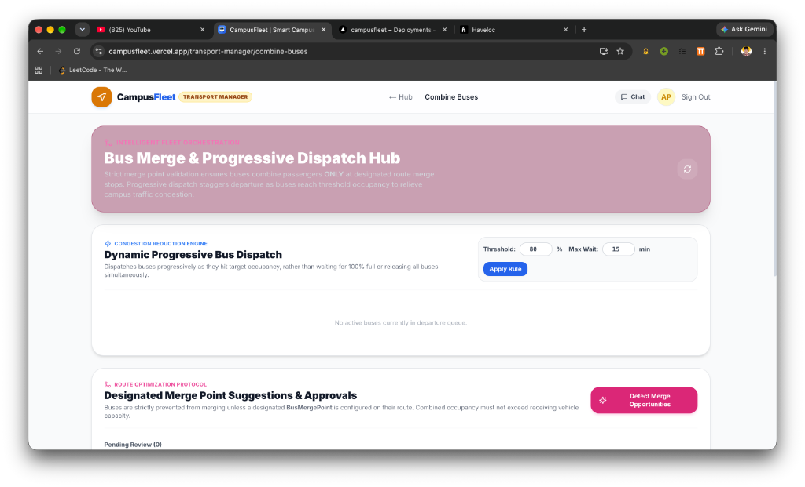
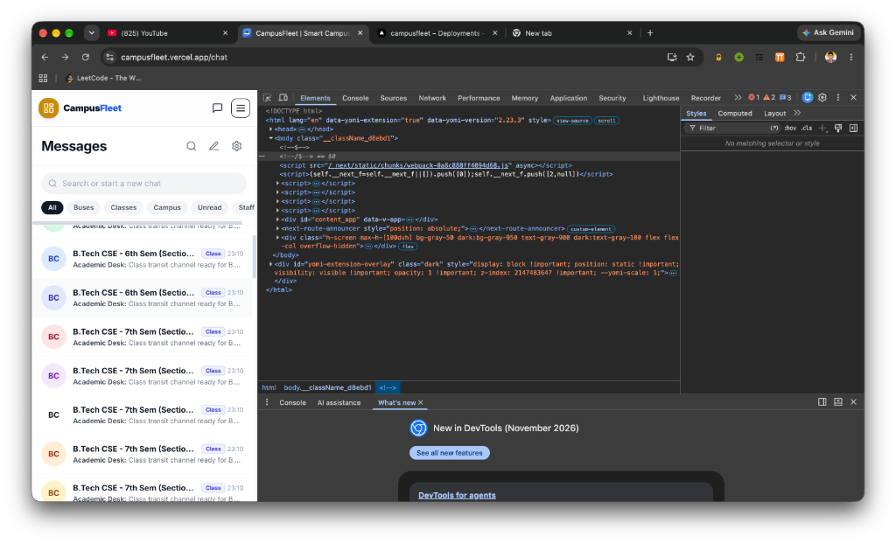
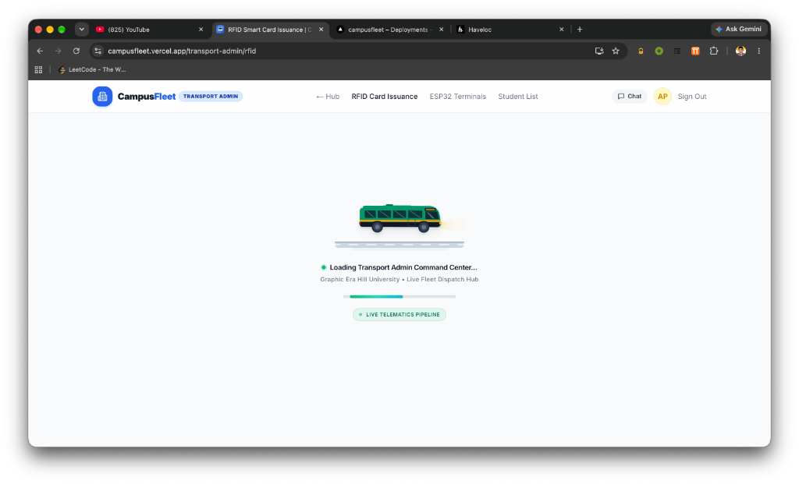

# 🚌 CampusFleet — Autonomous Campus Transit Intelligence & Fleet Telematics Platform

> **Production-Grade Full-Stack Transit Platform & IoT Telematics Ecosystem**  
> Built with **Next.js 14 (App Router), TypeScript, Tailwind CSS, Supabase PostgreSQL, Upstash Redis, Razorpay, Leaflet GIS, and ESP32 IoT Microcontrollers**.  
> Inspired by the seat allocation UX of **RedBus & AbhiBus**, the live radar experience of **Delhi Metro**, and the operational fleet intelligence of **Optibus & Samsara**.

[](https://campusfleet.vercel.app)
[](https://github.com/CampusFleet/platform)
[](https://github.com/CampusFleet/esp32-rfid-terminal)
[](https://github.com/CampusFleet/platform)

🌐 **Official Production URL**: [**https://campusfleet.vercel.app**](https://campusfleet.vercel.app)  
* 🚀 **Main Live Web App**: [https://campusfleet.vercel.app](https://campusfleet.vercel.app)  
* ⚡ **High-Availability Mirrors**: [https://ridx.vercel.app](https://ridx.vercel.app) • [https://campusfleet-live.vercel.app](https://campusfleet-live.vercel.app)  
* 🔌 **Dedicated IoT Firmware Repo**: [https://github.com/CampusFleet/esp32-rfid-terminal](https://github.com/CampusFleet/esp32-rfid-terminal)

---

## 📸 Application Interface & Visual Tour

### 1. Unified Gateway & Role Portal Launchers


### 2. Student & Parent Live Transit Radar (`/portal`)


### 3. RedBus/AbhiBus-Inspired 2×2 Seat Selection & Auto-Allocation (`/portal`)


### 4. Anti-Fraud Cryptographic Digital Boarding Pass (`/portal/qr`)


### 5. Full-Screen Live GPS Radar & Metro Station Progression (`/portal`)


### 6. Combine Buses — Fleet Orchestration & Fuel Rescuer (`/transport-manager/combine-buses`)


### 7. Campus Community Group Chat with Live Interactive Polls (`/chat`)


### 8. RFID Smart Card Issuance & Hardware Pairing (`/transport-admin/rfid`)


### 9. Creative Cartoonish Blue Loading Stage with Live Telematics Pipeline


### 10. Transport Admin Operations Control HUD & Analytics (`/admin`)


### 11. Conductor Manifest Desk & QR/RFID Attendance Scanner (`/conductor`)


### 12. Driver In-Cabin Mobile Console (`/driver`)
<p align="center">
  
</p>

---

## 🌟 Key Highlights & Latest Innovations

### 1. Attendance-Reconciled Hybrid Fleet Orchestration (Approach C)
* **Real-Time Attendance Reconciliation**: Reads morning shift boarding check-ins from `attendance_records` to immediately identify and prune absentee riders from the outgoing evening manifests.
* **Intra-Corridor Bus Disassembly at Merge Stops**: If two buses on the same corridor are operating at low load factors, the engine combines riders onto a single carrier vehicle at an authorized interchange stop and stands down the redundant bus at the depot (`STANDBY_DISASSEMBLED`), saving 5–8 Liters of diesel per run.
* **Clarke-Wright Multi-Corridor Route Stitching**: Merges low-occupancy adjacent routes ($\le 50\%$) by splicing active stops and bypassing empty ones, strictly bounded by maximum detour SLAs ($\le 15$ minutes).
* **Dynamic Progressive Bus Dispatch**: Staggers depot departures as buses reach target threshold occupancies (e.g. $80\%$), preventing campus parking gridlocks.
* **Strict Transit Hierarchy Rule**: Fully separates internal operational dispatches (`trip_id`, `trip_code`) from commuter interfaces. Students only see human-friendly labels: **Bus Number**, **Route Name**, and **Departure Time**.

### 2. Interactive Campus Group Chat & Live Polls (`/chat`)
* **Dynamic Institutional Groups**: Chat channels are partitioned dynamically by campus (e.g. `campus-gehu-bhimtal`). Group creation and deletion are locked from end-users to ensure roster integrity.
* **Live Interactive Polls**: Group members can create and vote on single/multi-choice polls with live percentage progress bars and real-time voter tallying.
* **Sub-2ms Redis Cache-Aside**: Chat messages and polls are cached in Upstash Redis (`chat:msgs:${conversationId}`) with 60-second sliding TTLs and instant cache invalidation on new messages, votes, reactions, and edits.
* **SVG Icon Standard**: Crisp Lucide React SVGs (`ThumbsUp`, `Heart`, `BusFront`) replacing OS-dependent emoji stickers for light and dark modes.

### 3. Dedicated IoT Hardware Architecture (ESP32 + RC522 RFID)
* **Isolated Hardware Repository**: Deployed to [CampusFleet/esp32-rfid-terminal](https://github.com/CampusFleet/esp32-rfid-terminal) with PlatformIO and Arduino IDE compatibility.
* **Self-Identity via Hardware MAC**: Bus terminals read their physical factory MAC address on startup — no hardcoded bus IDs are baked into firmware.
* **Sub-2ms Redis Heartbeat**: Terminals transmit lightweight heartbeats every 20 seconds, updating live status directly in memory with **0 SQL database load**.
* **Visual LED Feedback**: Pulses the onboard status LED 3 times upon successful card validation.

### 4. RedBus & AbhiBus-Inspired Seat Allocation Engine
* **Physical 2×2 Chassis Seat Map**: Realistic bus chassis layouts (`2x2`, `2x3`, `3x2`, continuous rear bench).
* **Atomic Distributed Seat Locking**: Redis `SETNX` + PostgreSQL `seat_attendance_transaction()` PL/pgSQL function prevents double-booking under high concurrency.
* **Semester Subscription Integration**: Seat selection acts as a digital boarding pass linked to conductor manifests.

### 5. 6 Graph Algorithms for Route Optimization (Zero External Library Imports)
* **Dijkstra's Shortest Path** — Optimal path between stops ($O((V+E)\log V)$).
* **Bellman-Ford Nearest Stops** — Discovers best nearby stops with connectivity bonuses.
* **A\* Search** — Point-to-point pathfinding using Haversine heuristic distance.
* **Floyd-Warshall All-Pairs** — Precomputes all-pairs shortest distances for dashboard analytics ($O(V^3)$, $O(1)$ query).
* **Kruskal's MST** — Calculates minimum road infrastructure connecting campus hubs.
* **Direct Express Engine** — Dynamically skips stops where zero active students alight.

### 6. Anti-Fraud Security & Verification
* **Rotating Cryptographic QR Nonces**: Digital passes regenerate HMAC tokens every 30 seconds to defeat static screenshots.
* **Geofence GPS Validation**: Attendance scans require conductor and student GPS coordinates to be physically within $<150\text{m}$ of the stop.
* **Passport Photo KYC Matching**: Conductor scanner displays verified student photos to prevent card/pass impersonation.

---

## 🚀 Technology Stack

### Frontend & Client
| Technology | Purpose |
|:---|:---|
| **Next.js 14 (App Router)** | Full-stack framework with React Server Components (RSC) and SSR |
| **React 18** | UI component rendering |
| **TypeScript** | Strict compile-time type safety across all domain entities |
| **Tailwind CSS** | Utility-first styling with responsive, accessible light/dark themes |
| **Framer Motion** | Micro-animations and tactile 3D transitions |
| **Leaflet & React-Leaflet** | Interactive GIS mapping with custom animated bus markers |
| **Lucide React** | Modern SVG icons (zero OS-dependent emoji stickers) |
| **jsQR & qrcode.react** | 60 FPS camera-based QR scanning and dynamic ticket rendering |

### Backend, Database & Telematics
| Technology | Purpose |
|:---|:---|
| **Supabase PostgreSQL** | Cloud-hosted relational database with Row Level Security (RLS) |
| **Supabase Realtime** | WebSocket bus location broadcasting and instant dispatch updates |
| **Upstash Redis** | Sub-2ms cache-aside layer, distributed seat locks, and live IoT heartbeats |
| **Next.js API Routes** | 31 API route groups (85+ REST endpoints) |
| **Razorpay** | Online payment gateway for semester transit passes and fee verification |
| **jose (JWT)** | HS256 cryptographically signed tokens with HttpOnly secure cookies |
| **MongoDB** | Real-time chat messages and interactive poll option persistence |

### IoT Hardware & Microcontrollers
| Technology | Purpose |
|:---|:---|
| **ESP32 Dev Module** | Wi-Fi / 4G Hotspot connected microcontrollers mounted on buses |
| **MFRC522 (RC522)** | 13.56 MHz RFID contactless smart card reader via SPI bus |
| **PlatformIO / Arduino** | Firmware toolchains for compilation, flashing, and OTA updates |

### Quality Assurance & Infrastructure
| Technology | Purpose |
|:---|:---|
| **Vitest** | 16 test suites (180 unit and integration tests passing) |
| **Vercel** | Serverless edge deployment with automatic CI/CD pipelines |

---

## 🗄️ Database Architecture (44 Tables + 9 Materialized Views)

The production Supabase PostgreSQL database includes **44 base tables**, **9 views**, and **10 atomic PL/pgSQL functions**:

### Core Schemas:
* **Fleet Management**: `buses`, `routes`, `route_stops`, `stops`, `campuses`, `transit_zones`, `shifts`.
* **Operations & Attendance**: `trips`, `bus_reservations`, `seat_attendance`, `attendance_records`, `attendance_reconciliation_runs`.
* **Fleet Orchestration**: `bus_merge_points`, `bus_merge_suggestions`, `dispatch_configs`.
* **People & Academic Hierarchy**: `users`, `students`, `staff`, `classes`, `academic_branches`, `academic_courses`.
* **Financial & Billing**: `subscription_plans`, `subscriptions`, `payment_submissions`.
* **Audit & Telematics**: `audit_logs`, `notifications`, `vehicle_issues`, `system_configs`.

---

## 📂 Project Organization

```text
CampusFleet/
├── platform/                                  # Main Next.js Full-Stack Web Platform (this repo)
│   ├── src/
│   │   ├── app/                               # Next.js 14 App Router routes
│   │   │   ├── portal/                        # Student & Parent Cockpit (Radar, Pass, Payments)
│   │   │   ├── driver/                        # Driver In-Cabin Console (GPS Telematics, Incidents)
│   │   │   ├── conductor/                     # Conductor Console (Camera Scanner, Passenger Manifest)
│   │   │   ├── transport-manager/             # Transport Manager (Combine Buses, Trips, Demand)
│   │   │   ├── transport-admin/               # Transport Admin (Routes, Corridors, RFID, ESP32, Billing)
│   │   │   ├── teacher/                       # Teacher Panel (Student Arrivals, Commute, Gate Passes)
│   │   │   ├── chat/                          # Campus Group Chat & Live Polls
│   │   │   └── api/                           # 31 REST API route groups
│   │   ├── components/                        # Reusable modular UI components
│   │   │   ├── common/BusLoadingScreen.tsx    # Creative Cartoonish Blue Loading Screen Bus
│   │   │   ├── chat/ChatPortalView.tsx        # Chat thread with interactive poll widgets
│   │   │   ├── transport-manager/             # Combine Buses & Fleet Orchestration Views
│   │   │   └── ...
│   │   └── lib/                               # Domain services, algorithms, and DB clients
│   │       ├── route-optimizer.ts             # 6 Graph Algorithms + Clarke-Wright Heuristics
│   │       ├── reservation-engine.ts          # Seat booking & concurrency controls
│   │       ├── chat-mongodb.ts                # MongoDB + Upstash Redis cache-aside
│   │       └── types.ts                       # Unified TypeScript entity interfaces
│   └── docs/screenshots/                     # High-resolution application screenshots
│
└── esp32-rfid-terminal/                       # Dedicated IoT Firmware Repository
    ├── src/main.cpp                           # C++ firmware with auto-MAC & 20s Redis heartbeat
    ├── platformio.ini                         # PlatformIO configuration
    └── README.md                              # Hardware wiring diagram (ESP32 ↔ RC522)
```

---

## 🛠️ Quick Start & Local Setup

### 1. Clone the Platform Repository
```bash
git clone https://github.com/CampusFleet/platform.git
cd platform
```

### 2. Install Dependencies
```bash
npm install
```

### 3. Configure Environment Variables
```bash
cp .env.example .env.local
```
Provide your Supabase URL, service role key, Razorpay credentials, and Upstash Redis tokens.

### 4. Run the Full Test Suite
```bash
npm test
```
*Executes all 16 test suites covering route optimization, seat locking, payments, telematics, and rollover.*

### 5. Start the Development Server
```bash
npm run dev
```
Open [http://localhost:3000](http://localhost:3000) to access the CampusFleet Gateway.

---

## 🧪 Interactive Walkthrough & Viva Guide

1. **Gateway (`/`)**: Select your role (Student, Driver, Conductor, Transport Admin, Transport Manager, Teacher).
2. **Student Dashboard (`/portal`)**: View live assigned bus, Metro-style station progression, and ETA countdown.
3. **RedBus 2×2 Seat Map**: Select an available seat with visual seat layout and atomic distributed concurrency locking.
4. **Digital Pass (`/portal/qr`)**: View the rotating anti-fraud QR ticket with physical seat number.
5. **Fee Payment (`/portal/payments`)**: Checkout semester pass through Razorpay sandbox or upload receipt.
6. **Campus Chat & Polls (`/chat`)**: Join the verified campus group, create a poll, and cast a vote.
7. **Driver Console (`/driver`)**: Start trip, broadcast live 15s GPS coordinates, and view route halts.
8. **Conductor Scanner (`/conductor`)**: Verify student QR codes with real-time geofence validation and locked KYC photos.
9. **Combine Buses (`/transport-manager/combine-buses`)**: Reconcile morning attendance actuals, view auto-detected bus disassemblies, stitch sparse routes, and execute 1-click Auto-Pilot.
10. **Transport Admin (`/transport-admin`)**: Manage corridors on interactive Leaflet maps, pair ESP32 telematics MAC addresses, and issue student RFID cards.

---

## 👥 Engineering Team & Credits

| Member | Focus Area |
|:---|:---|
| **Aditya Pandey** | Lead Architect, Full-Stack Next.js 14, & Routing Algorithms |
| **Harsh Kumar** | Database Architecture, Supabase PostgreSQL, & PL/pgSQL Atomic RPCs |
| **Kartik Bisht** | Frontend UX/UI, Mobile PWA, & Responsive Styling |
| **Gaurang Joshi** | Embedded IoT Hardware, ESP32 Telematics, & Quality Assurance |

* **Project Guide**: Prof. Rahul  
* **Institution**: Graphic Era Hill University (GEHU), Bhimtal Campus  
* **Live System**: [https://campusfleet.vercel.app](https://campusfleet.vercel.app)
